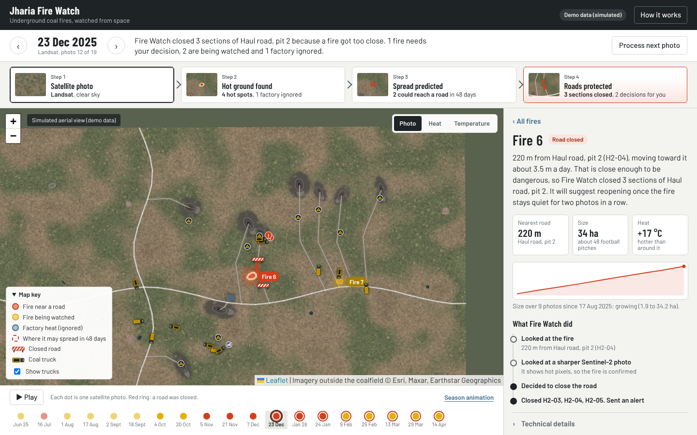
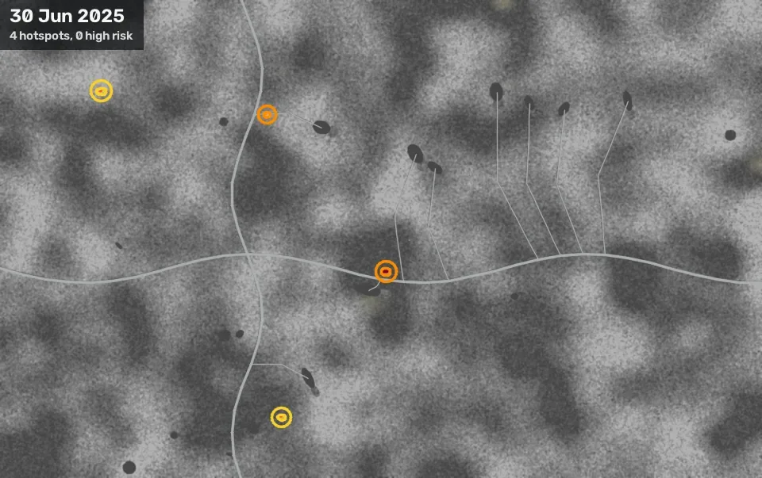

# Jharia Fire Watch



Coal seams under the Jharia coalfield in Jharkhand have been burning since 1916, and the ground above them subsides. Jharia Fire Watch reads every Landsat 8 and 9 pass over the coalfield, finds the hot ground, follows each fire from pass to pass, projects where it is heading over the next 48 days, and runs an agent that closes threatened roads, asks a person when it is unsure, and proposes reopening once a fire goes quiet. Only a person can reopen a road.

Built for the OpenCV AI Competition 2026, on OpenCV 5.0 and AWS.

## Run it

```bash
python3 -m venv .venv && . .venv/bin/activate
pip install -r requirements-dev.txt && pip install --no-deps -e .
firewatch download-models     # ALIKED, LightGlue and DISK ONNX files, about 56 MB, SHA-1 checked
firewatch demo --fresh        # 16 synthetic passes, the last 10 with the agent; about two minutes
firewatch serve               # http://localhost:8000; the dashboard at /dashboard asks for user demo, password demo
```

Python 3.12 or newer, no GPU, no AWS account. `pytest` runs 115 tests in about two minutes. With Docker instead: `docker compose build && docker compose run --rm seed && docker compose up api`.

### On real Landsat data

```bash
bash get_real_data.sh   # real Landsat 8/9 scenes of Jharia and OpenStreetMap roads, mines and plants
bash run_real.sh        # installs, processes the scenes and opens the dashboard
```

`get_real_data.sh` runs `scripts/fetch_real_data.py`, which searches Landsat Collection 2 Level-2 on Microsoft Planetary Computer (free, no account), keeps the scenes that cover the whole coalfield and are less than half cloudy over it, and reads only the coalfield window of each band: surface temperature (ST_B10), the six reflective bands and `QA_PIXEL`. A scene costs about 10 to 13 MB. It also saves roads, open-cast mines, plants and towns from OpenStreetMap. Run it again to resume. `run_real.sh` (or `firewatch -c config/real.yaml real`) turns the OpenStreetMap data into road sections of up to 400 m, truck routes from the largest mines to the nearest washery, and an industrial mask, then processes every scene in date order, the first three without the agent to build history. The base map is a true-colour Landsat photo of the clearest scene, and each date has its own photo.

### The pages

`http://localhost:8000/` is a public homepage, no sign-in: the latest photo's date and counts, "What brings you here?" cards that send each visitor where they need to go (road status, the dashboard, a guided tour, how it works), and a searchable list of closed roads from `/api/public/status`. `/help` is a help guide with a guided tour, the safety rules, a glossary, questions and troubleshooting. `/dashboard` is the dashboard, behind the login.

The dashboard opens on the latest satellite photo with one plain sentence about what happened on that date. Under it, four steps read left to right and double as a summary: the satellite photo and its cloud, the hot ground found, how many fires could reach a road in 48 days, and which roads are closed or waiting for a decision. Clicking a step changes the map: Photo, Heat (ground hotter than it should be) or Temperature. Fires are labelled on the map (Fire 6, Fire 7), factory heat is marked and ignored, and dashed outlines show where a fire may spread in 48 days. Closed roads carry barriers, and coal trucks drive each route, take a detour or wait at the mine when their road is shut. The side panel lists decisions waiting for a person first, then every fire on that date in one sentence each; clicking one gives a plain summary, its size and heat, a chart of its size over time and each step the agent took, with the technical numbers folded away. The dots along the bottom are the photos in date order: red means a high-risk fire, a red ring means a road was closed, and Play steps through the season. Roads, trucks and closures are shown as they stood on the selected date. "Process next photo" processes the next synthetic pass, or the next downloaded real scene.



## What happens on each pass

1. Band 10 becomes land surface temperature (radiance, brightness temperature, NDVI emissivity), with cloud, shadow and water taken from `QA_PIXEL`.
2. The pass is aligned to a reference pass with SIFT and `USAC_ACCURATE`. ALIKED + LightGlue on OpenCV 5's new DNN engine aligns it again on its own, and if the two disagree, the agent can ask DISK to settle it around the hotspot.
3. Heat that the surface explains (dark coal and bare dumps warm up in the sun) is regressed out against albedo and NDVI, smoothed first to the 100 m footprint of the thermal band, and what is left is compared with a local background. Hysteresis and OpenCV contours turn the anomalies into hotspots with an outline, a shape and a cloud-edge fraction. A weak blob is kept if it was there on the previous pass too.
4. Hotspots join tracks. DIS optical flow measures how the hot front moved since the last pass, and an advection–diffusion ensemble projects a 48-day spread cone.
5. Each hotspot gets a risk and a confidence score, with precedent from similar past fires found in a `cv2.ANNIndex`, and the agent takes over.

The agent closes roads within 250 m of a fire on its own only when risk is high and confidence is at least 0.7. Threats that only the projection shows, fires half under cloud, and anything it can't confirm go to a person with a recommendation. Coke ovens and other industrial heat are excluded. After two quiet passes it proposes reopening, which a person approves. Every step it takes, and why, is recorded and shown in the dashboard. Every map layer carries its own provenance as XMP metadata, written with OpenCV 5's `imencodeWithMetadata`.

Details: [architecture](docs/architecture.md), [the agent](docs/agent.md), [OpenCV 5 usage](docs/opencv5.md), [data sources](docs/data_sources.md), [technical report](docs/technical_report.md).

## Results so far

All on two synthetic coalfields whose fires, plants and clouds are known exactly: one the thresholds were tuned on, and one built afterwards and held out. `firewatch eval all` regenerates [reports/](reports/README.md).

| Check | Result |
| --- | --- |
| Temperature retrieval | 0.10 K mean absolute error against the known surface |
| Hotspot detection, 16 passes each | precision 1.00 in both worlds; recall 0.97 tuned, 0.86 held out. Without the albedo/NDVI step, precision falls to 0.16 |
| Alignment, 5 conditions × 5 pairs | SIFT 25 of 25 within half a pixel and the most accurate; ALIKED + LightGlue 21 of 25, failing on dry-season change |
| 48-day spread cone | covers 92 % of the ground a moving fire went on to burn, against 78 % for a circle of the same area; reach-a-road Brier score 0.038 against 0.145 |
| Precedent from past fires | separates fires that reached a road from those that did not with an ROC area of 0.97, one fire left out at a time |
| Agent, 38 scripted situations | 37 match a safety officer's call; no closure that wasn't called for, no fire dismissed; 10 of 10 safety checks |
| Run time | 7.3 s per full pass on two vCPUs, with two independent alignments |

The failures are in the reports. Young fires with less than about 4 K of contrast are missed until they grow. The held-out world showed false hotspots on a pond shore on its first run, which led to the footprint matching and the water mask. The projected cone is too wide, about 2.5 times the area a fire actually reaches in the held-out world. An unmapped plant without the vision-language model reaches a person as a false alarm. The scenario suite also caught two rules in the first version that were wrong: the agent closed a road for a fire 500 m away on the projection alone, and it ignored a real fire on the edge of a coke plant. Both rules are fixed ([docs/agent.md](docs/agent.md#what-the-scenario-suite-caught)).

## What is not proven yet

- **Real Landsat scenes have no ground truth.** The 23 real scenes from 4 November 2025 to 14 October 2026 all process end to end. Hot ground on the clear passes has a median of 2.9 km² (2.1 to 6.7), against NRSC's 1.89 km² for 2020, so the detector is in the right range but years apart from the reference ([reports/nrsc.md](reports/nrsc.md)). Most hotspots sit within 500 m of a mapped mine. Real data needed stricter thresholds (8 K seed, 4 K grow), a 100 m closure distance because roads are packed around the mines, and a 90 m position-noise allowance, because outlines change shape between passes and their centres jitter. On real data the agent closes only mine haul roads by itself; public roads go to a person. Over the season it closed 3 roads and raised 123 decisions, which nobody worked through, so they pile up. FIRMS has not been compared.
- **The vision-language model.** `vision/vlm.py` follows OpenCV 5's PaliGemma 2 sample, and the tests run its whole generation loop through `cv2.dnn.Tokenizer` and the new engine with small stand-in networks. The real 3-billion-parameter model has not been run; it is off by default.
- **The live AWS stack.** The template passes `cfn-lint` and the scripts pass `shellcheck`, and the S3, DynamoDB, SNS, CloudWatch and Bedrock adapters are tested against moto and stubs, but the stack has not been deployed from here.

## Deploy on AWS

Needs the AWS CLI v2, Docker with buildx, and an account in us-west-2 (where the USGS topic and bucket are).

```bash
ALERT_EMAIL=you@example.com infra/deploy.sh                       # synthetic demo on real AWS services
ALERT_EMAIL=you@example.com DATA_SOURCE=landsat infra/deploy.sh   # process new Landsat scenes
```

The script builds the arm64 image, pushes it to ECR, and creates the stack: S3 bucket, DynamoDB table, SNS alerts, an SQS queue subscribed to the USGS new-scene topic, a CloudWatch log group, a Secrets Manager password and a Graviton `t4g.large`. Run it again to roll out a new image. The stack outputs the dashboard URL and a command that prints the password (the user is `demo`). For Landsat mode, run `python scripts/fetch_osm.py` first so the image carries roads and industrial sites. The planner uses Amazon Nova Lite on Bedrock if model access is enabled, and falls back to the built-in policy if it is not.

## Repository

```
src/firewatch/       the package: data, geo, physics, vision, risk, agent, pipeline, services, api, evaluation
tests/               115 tests (physics, vision, readers, tracking, agent scenarios, VLM loop, API, AWS adapters, end-to-end)
reports/             evaluation results, regenerated by firewatch eval all
docs/                technical report, architecture, agent, OpenCV 5 notes, data sources, judge guide, video shot list
infra/               CloudFormation template and deploy script
config/              local, AWS and Landsat settings
scripts/fetch_osm.py roads and industrial sites from OpenStreetMap
```

## Credits

Landsat data courtesy of the U.S. Geological Survey. Sentinel-2 data from the Copernicus programme, via Element 84's Earth Search. Road and site data © OpenStreetMap contributors, ODbL. NRSC fire-area figures as reported by Bharat Coking Coal Limited. Leaflet 1.9.4 (BSD-2-Clause) and the Barlow typeface (SIL Open Font License) are vendored in `src/firewatch/api/static/vendor/`. Code under the MIT licence.
