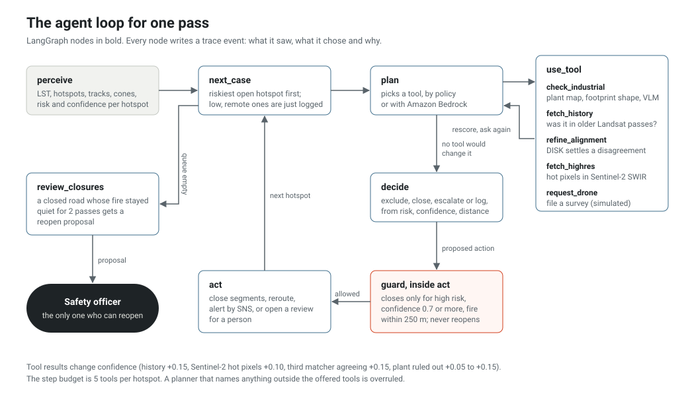

# The road-safety agent

After every pass, the agent goes through the hotspots that matter (risk at least 0.25, or near a road, under a cloud edge, or looking like a plant), decides what to do about each one, and does it. It can close roads, open a review for a person, file a drone survey and send alerts. It cannot reopen a road. The code is in `src/firewatch/agent/`, and the graph is in `graph.py`.

## What it sees

Each hotspot reaches the agent as a `Case` (`case.py`): the outline and heat statistics from OpenCV, the track history and its kinematics, the 48-day spread cone, a risk score, a confidence score, and six flags.

Risk (`risk/scoring.py`) mixes three parts, each between 0 and 1:

| Part | Formula | Weight |
| --- | --- | --- |
| Heat | `0.5 · mean / 12 K + 0.5 · peak / 24 K` | 0.35 |
| Spread | `max(growth per 30 days / 0.5, approach speed / 3 m per day)` | 0.30 |
| Proximity | `exp(−d / 400 m)`, where d is the smaller of today's distance to a road and the projected cone's distance | 0.35 |

High risk starts at 0.62 and medium at 0.40. Every constant lives in `defaults.yaml`.

Precedent can raise the spread part. Every earlier state of every track is kept in an OpenCV approximate-nearest-neighbour index (`cv2.ANNIndex`) with its size, heat, growth, speed, length of history and distance to a road, together with whether that fire came within 400 m of a road over the next 64 days. When a hotspot is still more than 400 m from a road and has at least three analogues from at least two other tracks, the spread part becomes the larger of its own value and the share of those analogues that reached a road. Left out one fire at a time on the two synthetic worlds, that share separates fires that went on to reach a road from those that did not with an area under the ROC curve of 0.97 (`reports/forecast.md`).

Confidence starts at 1 and loses points for what makes the measurement doubtful: a cloud edge around the hotspot (−0.35), failed alignment (−0.30) or a residual above 0.6 px (−0.15), SIFT and ALIKED + LightGlue disagreeing by more than 0.75 px (−0.25), a first sighting (−0.15), overlap with a mapped industrial site (−0.30), a scene more than half cloud (−0.10). Evidence gathered by tools moves it again: heat in earlier passes (+0.15), hot pixels in Sentinel-2 (+0.10), a third matcher agreeing with the alignment used (+0.15) or disagreeing with it (−0.10), the industrial check saying "fire" (+0.05, or +0.15 if the hotspot overlapped a plant).

## Which tool next

`policy.py: candidate_tools` turns the flags into the tools worth running, in this order:

| Flag | Tool | Question it answers |
| --- | --- | --- |
| Overlaps a plant, or rectangular, solid and above 20 K | `check_industrial` | Is this a coke oven or a fire? (map overlap, footprint shape, peak heat; the vision-language model if still unsure) |
| No track history yet | `fetch_history` | Was this spot already hot in the last four passes? |
| Alignment failed, residual above 0.6 px, or SIFT and ALIKED + LightGlue more than 0.75 px apart | `refine_alignment` | Does a third matcher (DISK, on a 640 px window around the hotspot) agree with the transform that was used? |
| Medium or high risk, or near a road | `fetch_highres` | Does the nearest clear Sentinel-2 image show hot pixels in shortwave infrared? |
| Still unconfirmed, near a road and moving toward it | `request_drone` | File a survey request (simulated here, deduplicated per track). |

A planner picks one tool from that list. `PolicyPlanner` takes the first. `LLMPlanner` sends the case summary and the allowed tools to Amazon Bedrock and expects `{"tool": ..., "rationale": ...}` back; anything that isn't one of the allowed tools falls back to the policy choice, and the graph checks the choice again before running it. After each tool the case is rescored and the planner is asked again. The loop ends when no tool is left or after five tools.

The planner only chooses evidence. It never chooses an action, so a misbehaving model can waste a tool call but cannot close a road.

## How it decides

`policy.py: decide`, in order:

1. Excluded as industrial: **exclude**.
2. Cloud edge, and the hotspot is near a road or not low risk: **escalate**, because the true extent is unknown.
3. High risk:
   - automatic closure switched off, no road segment within 250 m of the hotspot or its cone, or confidence below 0.7: **escalate**;
   - the fire itself is more than 250 m from every road and only the projection reaches one: **escalate** with the threatened segments as the recommendation, because the next satellite pass will come before the fire does;
   - otherwise **close** every segment within 250 m of the hotspot or its cone.
4. Medium risk: **escalate**.
5. Low risk but confidence under 0.5 near a road: **escalate**.
6. Otherwise **log** and keep watching.

## The guard

`guard.py` sits between the decision and the action executor. It allows the agent to close roads, keep them closed, escalate, notify, exclude, log, propose a reopening and request a drone. It refuses anything else. A closure by the agent needs all of: the decision was `close`, the risk is high, confidence is at least 0.7, and `agent.allow_auto_close` is on. A refused closure is recorded as `blocked` and turned into an escalation.

Reopening is human-only, whoever asks. The agent can only propose it, after the fire behind a closure has stayed below medium risk (or out of sight while the spot was cloud-free) for two passes. A pass where the spot is under cloud does not count as quiet. A person approves in the dashboard or with `firewatch approvals approve <id>`, which reopens the segments, records the action under their name and reports the restored routes.

## Memory between passes

| What | Where | Why |
| --- | --- | --- |
| Tracks | `track` records: points, kinematics inputs, `closed_segments`, `quiet_passes`, `label` | A plant found once stays excluded (`label = "industrial"`) without asking again. |
| Reviews | one pending `review_hotspot` approval per track | Later passes refresh it instead of opening a new one, and alert again only when the risk level goes up. An automatic closure marks it `superseded`. |
| Closures | `closure` records per segment | Rebuilt into the road network on every start, so the API and worker agree. |
| Reopen proposals | one pending `reopen_road` approval per track | Repeated reviews do not stack proposals. |
| Drone requests | `task` records | One open request per track. |

Over 13 agent passes of the demo (`firewatch demo --passes 13`), with three tracks needing attention on most of them, this produced 6 notifications in total.

## Traces

Every node writes a `TraceEvent` (`trace.py`): run id, sequence number, time, node, hotspot, what it observed, what it chose, the tool result, and a one-line rationale. Traces go to `runs/<run>/trace.jsonl` in the blob store, to CloudWatch Logs when `observability.log_group` is set, and to the dashboard's "What the agent did" list.

This one is from the demo pass of 4 October 2025 (`SYN_+000_20251004-h02`). The perception numbers come straight from OpenCV: the hotspot covers 42 % of the mapped coke-oven polygon, `cv2.minAreaRect` gives a rectangularity of 0.86 and `cv2.convexHull` a solidity of 0.97, and the peak is 32.0 K above its surroundings. Those numbers set the `industrial_candidate` flag, so `check_industrial` comes before `fetch_highres`:

| # | Node | What happened |
| --- | --- | --- |
| 10 | observe | risk 0.55 (medium), confidence 0.70, flags: industrial candidate, near road |
| 11 | plan | options `check_industrial`, `fetch_highres`; chose `check_industrial`: "42% overlap with a mapped industrial site and a 0.86 rectangularity; rule out a plant before treating it as a coal fire" |
| 12 | tool | verdict industrial, score 0.75: overlap, rectangular footprint, 32 K peak |
| 13 | plan | no tool left that could change the decision, so the Sentinel-2 check never runs |
| 14 | decide | exclude |
| 15 | act | exclude, no alert |

The 23 December pass shows the other end. Fire A (track T0006) is 218 m from haul road H2 with its cone 29 m away; Sentinel-2 shows 141 hot pixels; the agent closes H2-03, H2-04 and H2-05 and sends one alert with the detour. On the three passes before that, the same fire was already high risk, but only because of its projection (the fire itself was 436, 359 and 285 m away), so the agent asked a person instead.

The alignment tie-break is in the scenario suite: in A08 the two matchers are 1.4 px apart and DISK sides with SIFT, so confidence recovers and the agent closes; in A09 DISK sides with ALIKED, nothing independent confirms the fire, and the agent asks a person and files a drone survey.

## What the scenario suite caught

`firewatch eval agent` runs 36 scripted situations through the real graph, policy, guard and executor (`reports/agent.md`). Its first run found two real problems:

- **A04, a fire 500 m away moving 8 m a day.** The agent closed the road on the strength of the 48-day projection alone. Now a projection-only threat goes to a person, and the agent closes by itself only when the fire is within 250 m.
- **C05, a real fire straddling the edge of a coke plant.** Overlapping a mapped site by 30 % was enough to call it industrial and ignore it. Now an overlap below 70 % also needs a building-like footprint, or a yes from the vision-language model, before a hotspot is excluded.

One scenario still fails on purpose. C04, an unmapped plant with no vision-language model, goes to a person instead of being excluded: a false alarm, never a missed fire.

## How much the constants matter

The weights and thresholds are set by hand, so the suite runs again with one of them moved at a time: each weight by 20 %, each threshold by 0.05 and the 400 m proximity scale by 25 %. Most changes flip no decision or one. The confidence bar for closing is the sensitive one: at 0.65 instead of 0.70, A06, A09 and E03 close instead of escalating. All three sit at a confidence of exactly 0.65 by construction (failed or disputed alignment, a first sighting, Sentinel-2 confirmation), which is the line the 0.70 bar is meant to hold. A high-risk threshold of 0.57, or a spread weight 20 % lower, makes the agent close for B09, a strong fire 60 m from a road with no measured spread, which the scenario leaves to a person. Raising the medium threshold to 0.45, or shrinking the proximity scale to 300 m, turns B03, a moderate, slow fire 300 m from a road, from a review into a log entry; that is the one place a small change would let a fire past a person.

## Using Bedrock

Set `agent.planner: bedrock` (the AWS config does) and enable access to the model in `agent.bedrock_model_id` in the Bedrock console. The default is the cross-region profile `us.amazon.nova-lite-v1:0`. The instance role in `infra/cloudformation.yaml` allows `bedrock:InvokeModel` on foundation models and inference profiles. If a call fails, `BedrockLLM.complete` returns nothing and the policy planner takes over for that step, which the trace records as `policy-fallback`. Bedrock also writes the alert text, from the same facts the template uses.
