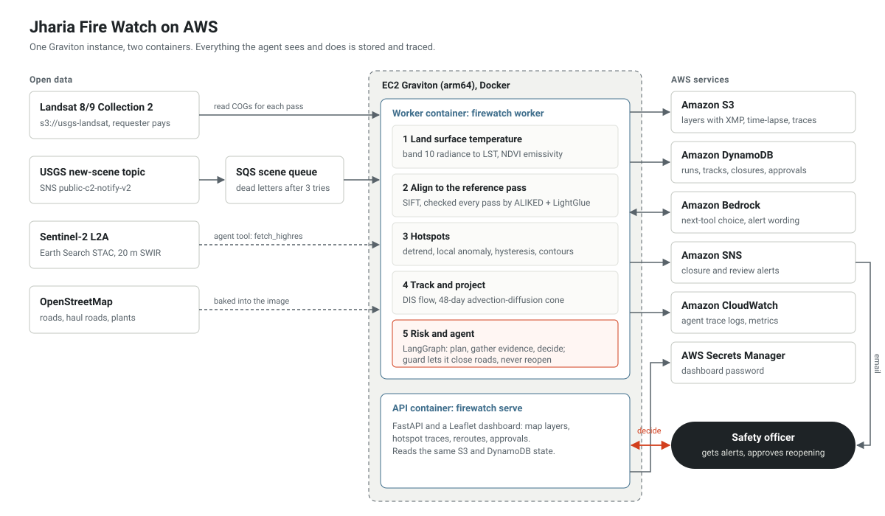

# Architecture



The same Python package runs everywhere. On a laptop it uses SQLite, a folder of files and a console outbox; on AWS the same code uses DynamoDB, S3 and SNS, picked by configuration (`services/factory.py`).

## Code layout

```
src/firewatch/
  cli.py                 firewatch command: demo, run, backfill, search, approvals, serve, worker, eval, ...
  config.py, defaults.yaml   settings with strict validation; YAML files and FIREWATCH__ environment overrides
  models.py              dataclasses passed between stages (SceneRef, Hotspot, Track, Projection, ...)
  data/                  scene sources: synthetic.py, landsat.py (STAC + COG windows), sentinel2.py, mtl.py, stac.py
  geo/                   the 30 m UTM grid, raster reading and reprojection
  physics/               radiometry, emissivity and albedo, thermal products, heat-spread model
  vision/                OpenCV: clouds, anomaly, hotspots, registration, flow, tracking, similarity, SWIR check, plant check, VLM, media (XMP, animation)
  risk/                  road network (shapely + networkx), risk and confidence scoring
  agent/                 LangGraph agent: case, policy, planner, tools, guard, actions, approvals, trace
  pipeline/              context, one pass (process.py), projection, analogues, map products, time-lapse, runner, SQS worker
  services/              blob store, key-value store, notifier, LLM, observability (local and AWS versions)
  api/                   FastAPI app and the static dashboard
  evaluation/            evaluation suites and the agent scenarios
```

## One pass

`pipeline/process.py: run_pass` does the following for one scene. Numbers are the defaults.

1. **Load** the scene window onto the 30 m grid: band 10 as DNs, five reflective bands, `QA_PIXEL`, and the MTL constants.
2. **Thermal.** Radiance from DNs, brightness temperature from K1 and K2, emissivity from NDVI, then land surface temperature. Clouds, shadows and fill are masked from `QA_PIXEL` and dilated by 2 pixels, and its water bit is kept as a separate mask. Broadband albedo uses Liang's coefficients.
3. **Align.** The NIR band is scaled to 8 bits with CLAHE and matched to the reference pass (the first pass with at most 30 % cloud, stored at `reference/registration.npz`). SIFT keypoints are matched with a ratio test, and `cv2.estimateAffine2D` with `USAC_ACCURATE` fits the transform. A fit is accepted with at least 25 inliers, a scale within 2 % of 1, and a plausible shift. ALIKED + LightGlue then aligns the same pair on its own, and the distance between the two transforms is recorded; if SIFT failed and ALIKED did not, ALIKED's transform is used. All thermal layers are warped onto the reference grid. Phase correlation before and after is recorded as a check.
4. **Anomaly.** A Huber-weighted fit of temperature against albedo, NDVI and NDVI² removes the part of the temperature that the surface explains: dark coal and bare dumps heat up in the sun without any fire. Albedo and NDVI are first smoothed to the footprint of the thermal band (a masked Gaussian with σ 1.4 px, since band 10 is 100 m resampled to 30 m), so that a sharp edge between dark coal and a brighter surface does not leave a warm fringe. Water and a 2-pixel ring around it are left out. What is left is compared with its own local background, a masked 61 × 61 pixel box mean that ignores clouds and, after the first round, the hot pixels themselves. Dividing by a robust sigma (1.4826 × MAD) gives a z-score.
5. **Hotspots.** Hysteresis: pixels with z ≥ 3 and at least 4 K of contrast seed a hotspot, which grows over neighbours with z ≥ 1.8 and 1.5 K. Regions under 6 pixels are dropped. Persistence then keeps a weaker blob (z ≥ 2, at least 2.5 K and 4 pixels) when it overlaps a candidate or hotspot from the previous pass, which catches fires that are weak but steady. Each region gets a contour (`cv2.findContours`, simplified to at most 64 vertices), a heat-weighted centroid, its area, solidity, rectangularity and elongation, the fraction of its 3-pixel ring that is cloud, and its overlap with mapped industrial sites.
6. **Track.** Hotspots are matched to existing tracks when the track's predicted position is within 450 m or the outlines overlap. Kinematics come from straight-line fits over the last 8 points: area growth, velocity, heading, and the trend in heat. A track that is not seen on a pass where its spot was cloud-free counts a miss, and goes inactive after three.
7. **Front motion.** DIS optical flow between the previous and current anomaly maps, weighted by edge strength around the hotspot, gives a second velocity estimate.
8. **Spread.** Track and flow velocities are blended (60/40 with three or more points), diffusivity comes from area growth, and decay from a cooling trend.
9. **Projection.** 24 runs of an upwind advection–diffusion model over 48 days, each drawing its speed with a 35 % standard deviation and its heading with 15°. The cone is the area covered in at least 20 % of runs. The share of runs touching a road gives the reach probability.
10. **Risk and confidence,** with precedent from the nearest past track states in a `cv2.ANNIndex`, then the agent (see [agent.md](agent.md)).
11. **Persist** hotspots, tracks and the run summary to the key-value store, and the map layers, GeoJSON outlines, compressed arrays and the trace to the blob store. Each WebP layer carries its provenance as XMP (`cv2.imencodeWithMetadata`): run, scene, time, platform, WGS84 bounds, value range and units. A time-lapse frame of the pass is drawn with OpenCV and stored too. Metrics go to CloudWatch when configured.

A full-size synthetic pass (1364 × 857 pixels) takes a median 7.3 s on two vCPUs. Alignment takes about 4.4 s, most of it the second, independent alignment with ALIKED + LightGlue; writing the map layers and the time-lapse frame takes 1.5 s; the agent itself takes under 0.1 s when every tool answers from the synthetic source (`reports/bench.md`).

## Getting scenes in

| Path | Command | Used for |
| --- | --- | --- |
| Live | `firewatch worker` reads the SQS queue subscribed to the USGS topic, pulls product ids out of each message, skips path/rows not listed in `worker.path_rows` (when set), scenes outside the area and scenes that fail `keep_landsat`, and runs the pass. A message that fails stays on the queue for a retry; after three failures it moves to the dead-letter queue. | AWS deployment with `DataSource=landsat` |
| Range | `firewatch backfill --start 2025-01-01 --end 2025-05-31` | Building history, NRSC comparison |
| One scene | `firewatch run --scene-id LC09_L1TP_140044_...` or `POST /api/runs` | Checking a specific scene |
| Synthetic | `firewatch demo`, or "Process next photo" in the dashboard | Demo and tests |
| Downloaded real scenes | `bash get_real_data.sh`, then `firewatch -c config/real.yaml real` (or "Process next photo") | Real Landsat Collection 2 Level-2 scenes from Microsoft Planetary Computer, read by `data/real.py`; OpenStreetMap turned into road sections, mines, plants and truck routes by `data/osm.py` |

Passes run one at a time per process. The API runs them on a background thread and answers `409` to a second request while one is running.

## Storage

Key-value records (DynamoDB single table with `pk` = kind and `sk` = key, or one SQLite table with the same shape):

| Kind | Key | Holds |
| --- | --- | --- |
| `run` | run id | scene, status, timings, alignment, decisions, actions |
| `hotspot` | `run#hotspot` | outline, heat, risk, projection, evidence, tools used, decision |
| `track` | track id | points, closed segments, quiet passes, label |
| `closure` | segment id | open or closed, by whom, since when, why |
| `approval` | approval id | review or reopen request, status, decision, outcome |
| `task` | task id | drone survey requests |
| `action` | `run#action` | every action by the agent or a person |
| `meta` | name | reference scene, last run, track counter, demo position |

Blobs (S3 under `firewatch/`, or `var/blobs/`): `static/grid.json`, `static/roads.geojson`, `static/industrial.geojson`, `static/routes.json`, `reference/registration.npz`, `timelapse/season.webp`, and per run `runs/<run>/lst.webp`, `anomaly.webp`, `frame.webp`, `hotspots.geojson`, `cones.geojson`, `maps.npz`, `trace.jsonl`.

## Configuration

`defaults.yaml` holds every setting. Files passed with `-c` are merged on top in order, then environment variables of the form `FIREWATCH__SECTION__KEY` (for example `FIREWATCH__STORAGE__BUCKET=my-bucket`). Unknown keys are an error, so a typo fails at start-up instead of being ignored.

| File | Sets |
| --- | --- |
| `config/local.yaml` | synthetic scenes, SQLite, local files, console notifier, policy planner |
| `config/aws.yaml` | S3, DynamoDB, SNS, CloudWatch, Bedrock planner; resource names come from the environment |
| `config/landsat.yaml` | real Landsat scenes, OSM roads and plants, example dumper routes |

## The dashboard

`firewatch serve` starts FastAPI with HTTP Basic login (user and password from `api.*`). The page at `/` is plain JavaScript with a vendored Leaflet 1.9.4 and no build step. Under the date, one sentence says what happened, and four steps (satellite photo, hot ground found, spread predicted, roads protected) summarise the pass and switch the map between the photo, heat above normal and surface temperature. The base map is an aerial view: for a synthetic world, `data/scenery.py` renders one at 10 m from the world's own layout and stores it as `static/scenery.webp`; for real data it is a true-colour Landsat photo of the clearest scene, each pass also has its own photo layer, and Esri World Imagery fills the area outside the coalfield. Mines, plants and towns come from `/api/sites`, and trucks are animated in the browser along each route's path from `/api/routes`; roads, barriers and trucks are drawn as they stood on the selected pass. The side panel lists pending decisions, then every fire on the pass in one sentence, and opens a plain-language view of one fire with its size over time and each agent step, technical numbers folded away. Dots along the bottom are the passes in date order, with Play. Everything it shows comes from the JSON API under `/api/`, so the same data is available to scripts: `/api/timelapse` returns the season as an animated WebP (`cv2.imencodeanimation`), and `/api/runs/<run>/layers/<name>/provenance` reads a layer's XMP back.

## Deployment

`infra/cloudformation.yaml` creates the bucket, table, alert topic, scene queue with dead-letter queue and USGS subscription, log group, dashboard secret, IAM role and a Graviton instance (`t4g.large` by default). The instance installs Docker, logs in to ECR, pulls the image and starts the API container, plus the worker in Landsat mode. `infra/deploy.sh` builds the arm64 image, pushes it, and either creates the stack or rolls the running instance onto the new image through SSM. The template passes `cfn-lint`, and the scripts pass `shellcheck`. Deploy in us-west-2, where the USGS topic and bucket are.
