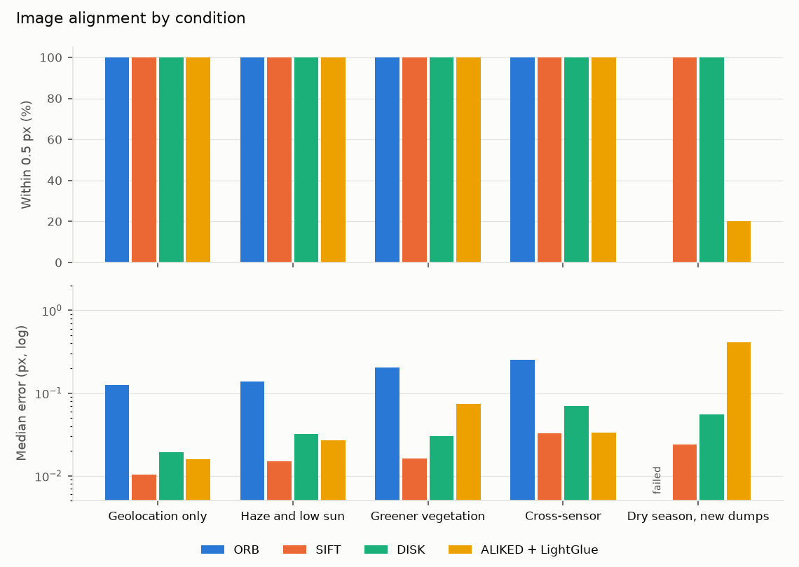

# Alignment: classic features vs OpenCV 5 learned features

Synthetic NIR image pairs (640 px square, 5 per condition) with a known shift and rotation of up to 2 px and 0.15 degrees. Error is the RMS distance between the estimated and true transform over a grid of points. Every method fits the transform with USAC_ACCURATE (cv2.estimateAffine2D); the estimator comparison further down is why. The dry-season pair is the hard one: vegetation darkens and bare soil brightens in the near infrared, which reverses local contrast, and thirty new dumps and pits appear.

| Condition | Method | Registered | Within 0.5 px | Median error (px) | 90th pct error (px) | Inliers | Seconds |
| --- | --- | --- | --- | --- | --- | --- | --- |
| Geolocation only | ORB | 5/5 | 100% | 0.125 | 0.206 | 2354 | 0.270 |
| Geolocation only | SIFT | 5/5 | 100% | 0.010 | 0.011 | 2873 | 0.730 |
| Geolocation only | DISK | 5/5 | 100% | 0.019 | 0.025 | 1560 | 23.200 |
| Geolocation only | ALIKED + LightGlue | 5/5 | 100% | 0.016 | 0.019 | 825 | 3.440 |
| Haze and low sun | ORB | 5/5 | 100% | 0.138 | 0.215 | 699 | 0.190 |
| Haze and low sun | SIFT | 5/5 | 100% | 0.015 | 0.018 | 2061 | 0.610 |
| Haze and low sun | DISK | 5/5 | 100% | 0.032 | 0.051 | 1206 | 22.050 |
| Haze and low sun | ALIKED + LightGlue | 5/5 | 100% | 0.027 | 0.040 | 773 | 3.290 |
| Greener vegetation | ORB | 5/5 | 100% | 0.205 | 0.251 | 848 | 0.200 |
| Greener vegetation | SIFT | 5/5 | 100% | 0.016 | 0.019 | 1470 | 0.730 |
| Greener vegetation | DISK | 5/5 | 100% | 0.030 | 0.038 | 1411 | 21.790 |
| Greener vegetation | ALIKED + LightGlue | 5/5 | 100% | 0.074 | 0.095 | 693 | 3.240 |
| Cross-sensor | ORB | 5/5 | 100% | 0.251 | 0.298 | 921 | 0.220 |
| Cross-sensor | SIFT | 5/5 | 100% | 0.033 | 0.042 | 670 | 0.650 |
| Cross-sensor | DISK | 5/5 | 100% | 0.070 | 0.082 | 659 | 21.040 |
| Cross-sensor | ALIKED + LightGlue | 5/5 | 100% | 0.033 | 0.038 | 646 | 3.120 |
| Dry season, new dumps | ORB | 0/5 | 0% |  |  | 4 | 0.210 |
| Dry season, new dumps | SIFT | 5/5 | 100% | 0.024 | 0.027 | 406 | 0.660 |
| Dry season, new dumps | DISK | 5/5 | 100% | 0.055 | 0.102 | 658 | 21.710 |
| Dry season, new dumps | ALIKED + LightGlue | 1/5 | 20% | 0.414 | 0.414 | 19 | 2.920 |

## RANSAC, MAGSAC++ or USAC_ACCURATE

The same SIFT matches, fitted with each robust estimator that cv2.estimateAffine2D offers. The last rows keep 200 true matches from a clean pair and add random false ones until they make up the stated share. Each cell gives the share of pairs within 0.5 px and the median error.

| Case | RANSAC | MAGSAC++ | USAC_ACCURATE |
| --- | --- | --- | --- |
| Geolocation only | 100%, 0.011 px | 100%, 0.011 px | 100%, 0.010 px |
| Haze and low sun | 100%, 0.015 px | 100%, 0.019 px | 100%, 0.015 px |
| Greener vegetation | 100%, 0.015 px | 100%, 0.018 px | 100%, 0.016 px |
| Cross-sensor | 100%, 0.048 px | 100%, 0.052 px | 100%, 0.033 px |
| Dry season, new dumps | 100%, 0.024 px | 100%, 0.024 px | 100%, 0.024 px |
| 50% outliers | 100%, 0.018 px | 100%, 0.020 px | 100%, 0.018 px |
| 80% outliers | 100%, 0.018 px | 100%, 0.031 px | 100%, 0.018 px |
| 90% outliers | 100%, 0.018 px | 100%, 0.057 px | 100%, 0.018 px |
| 95% outliers | 80%, 0.018 px | 100%, 0.031 px | 100%, 0.018 px |

| Case | Estimator | Inliers | Milliseconds |
| --- | --- | --- | --- |
| 50% outliers | RANSAC | 200 | 0.300 |
| 50% outliers | MAGSAC++ | 200 | 0.500 |
| 50% outliers | USAC_ACCURATE | 200 | 0.900 |
| 80% outliers | RANSAC | 200 | 1.900 |
| 80% outliers | MAGSAC++ | 200 | 1.300 |
| 80% outliers | USAC_ACCURATE | 200 | 2.600 |
| 90% outliers | RANSAC | 200 | 22.100 |
| 90% outliers | MAGSAC++ | 200 | 9.600 |
| 90% outliers | USAC_ACCURATE | 200 | 12.200 |
| 95% outliers | RANSAC | 166 | 57.300 |
| 95% outliers | MAGSAC++ | 200 | 19.200 |
| 95% outliers | USAC_ACCURATE | 200 | 26.500 |

These pairs are synthetic, so the numbers rank the methods under controlled conditions; they are not accuracy figures for real Landsat scenes.
