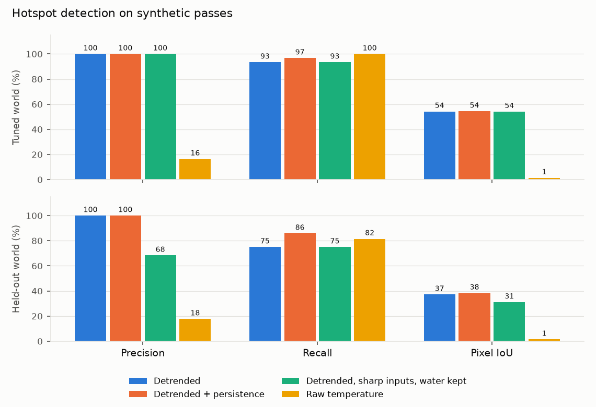

# Hotspot detection against synthetic ground truth

Sixteen passes of two synthetic worlds. The tuned world is the one the thresholds were set on: five fires (one starts mid-season, one goes out by itself in October, one is put out in January), a mapped coke-oven battery and occasional cloud. The held-out world was built afterwards and never used for tuning: a different seed, seven irregular multi-lobed fires (three moving toward roads, two starting late, two going out), weaker heat, 1.7 times the sensor noise, more cloud, and a second coke plant that is missing from the industrial map.

A fire counts as present when at least the minimum hotspot area of its true heat footprint is cloud-free. Detections on coke plants are counted separately, because excluding them is the agent's job. Persistence keeps a weak blob (2.5 K or more, at least 4 pixels) only if it overlaps a candidate or hotspot from the previous pass.

| World | Variant | Precision | Fires found | False hotspots per pass | Mean pixel IoU | Kept by persistence |
| --- | --- | --- | --- | --- | --- | --- |
| tuned | detrended | 1.000 | 57 of 61 (0.934) | 0.000 | 0.543 | 0 |
| tuned | detrended + persistence | 1.000 | 59 of 61 (0.967) | 0.000 | 0.544 | 2 |
| tuned | detrended, sharp inputs, water kept | 1.000 | 57 of 61 (0.934) | 0.000 | 0.541 | 0 |
| tuned | raw temperature | 0.164 | 61 of 61 (1.000) | 19.375 | 0.014 | 0 |
| held-out | detrended | 1.000 | 69 of 92 (0.750) | 0.000 | 0.372 | 0 |
| held-out | detrended + persistence | 1.000 | 79 of 92 (0.859) | 0.000 | 0.383 | 10 |
| held-out | detrended, sharp inputs, water kept | 0.683 | 69 of 92 (0.750) | 2.000 | 0.311 | 0 |
| held-out | raw temperature | 0.177 | 75 of 92 (0.815) | 20.875 | 0.015 | 0 |

Detrending fits temperature against albedo and NDVI before looking for local anomalies. Without it, dark coal surfaces heated by the sun look like fires.

## What the held-out world caught

Its first run gave false hotspots on every pass, always in the same place: the shore of a pond next to a coal pit. The row "detrended, sharp inputs, water kept" is the detector as it was then: 2.0 false hotspots per pass and a precision of 0.68 on this world. Two things were wrong. The albedo and NDVI used for detrending were sharp 30 m values while the thermal band is 100 m resampled to 30 m, so every sharp edge between dark coal and a brighter surface left a warm fringe. And open water, about 20 K colder than the land around it, dragged the local background down. The detrending inputs are now smoothed to the thermal footprint (Gaussian, sigma 1.4 px), and water pixels from the QA band plus a 2-pixel ring are left out of the background and of detection. That removed every false hotspot in both worlds without losing a fire. The held-out world is no longer untouched after that fix, so the next unseen test has to be real scenes.

## Fires missed in the tuned world (detrended + persistence)

Peak contrast is the true fire heat after the sensor blur. A new hotspot needs 4 K; a persistent one 2.5 K.

| Scene | Fire | True footprint (px) | Peak contrast seen (K) |
| --- | --- | --- | --- |
| SYN_-006_20250630 | A | 9 | 3.600 |
| SYN_-005_20250716 | A | 8 | 3.800 |

## Fires missed in the held-out world (detrended + persistence)

Peak contrast is the true fire heat after the sensor blur. A new hotspot needs 4 K; a persistent one 2.5 K.

| Scene | Fire | True footprint (px) | Peak contrast seen (K) |
| --- | --- | --- | --- |
| SYN_-006_20250630 | H1 | 6 | 2.000 |
| SYN_-006_20250630 | H2 | 12 | 2.700 |
| SYN_-005_20250716 | H1 | 7 | 2.300 |
| SYN_-005_20250716 | H5 | 9 | 3.200 |
| SYN_-004_20250801 | H1 | 15 | 2.700 |
| SYN_-003_20250817 | H1 | 22 | 3.200 |
| SYN_-003_20250817 | H3 | 11 | 2.900 |
| SYN_-003_20250817 | H7 | 9 | 2.500 |
| SYN_-002_20250902 | H1 | 29 | 3.300 |
| SYN_-002_20250902 | H3 | 17 | 3.500 |
| SYN_-002_20250902 | H4 | 13 | 2.800 |
| SYN_-002_20250902 | H6 | 11 | 1.800 |
| SYN_-001_20250918 | H6 | 25 | 3.300 |
