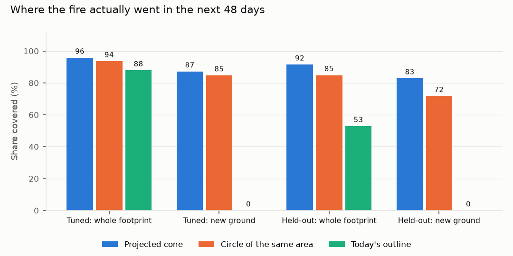

# Spread projection and precedent against synthetic truth

Every pass of a full season (19 passes) in both synthetic worlds goes through the pipeline. For each hotspot that gets a projection, the cone is compared with where the matching true fire actually burned over the next 48 days, sampled every 4 days. Two baselines get the same test: today's outline (the fire stays put) and a circle grown around today's outline to the same area as the cone (the fire spreads, but with no direction). "New ground" is the part of the future footprint that is not burning today, which is the part a projection has to earn.

| World | Projections | Fire went out | Cone covers | Same-area circle covers | Today's outline covers | New ground: cone vs circle | Cone area / true area | Cone precision |
| --- | --- | --- | --- | --- | --- | --- | --- | --- |
| tuned | 38 | 0 | 96% | 94% | 88% | 87% vs 85% | 1.262 | 81% |
| held-out | 69 | 0 | 92% | 85% | 53% | 83% vs 72% | 2.531 | 56% |

## Moving and static fires

| World | Fires | Projections | Cone covers | Circle covers | New ground: cone vs circle |
| --- | --- | --- | --- | --- | --- |
| tuned | moving | 21 | 92% | 91% | 87% vs 85% |
| tuned | static | 17 | 100% | 97% | n/a vs n/a |
| held-out | moving | 46 | 94% | 84% | 92% vs 78% |
| held-out | static | 23 | 87% | 86% | 64% vs 59% |

## Will it reach a road?

Cases where neither today's outline nor the true fire already touches a road. Brier score of the ensemble's reach probability, next to the score of always forecasting the observed rate.

| World | Cases | Actually reached | Brier | Brier of the base rate |
| --- | --- | --- | --- | --- |
| tuned | 11 | 0 | 0.093 | 0.000 |
| held-out | 51 | 9 | 0.038 | 0.145 |

## Precedent from similar past fires

The analogue index (cv2.ANNIndex over size, heat, growth, speed, history and road distance) is tested on 185 track states from 16 tracks in both worlds, leaving out one fire at a time (16 fires and plants), so that a fire whose track broke in two cannot vouch for itself. Only states more than 400 m from a road count, since only those can go on to reach one: 94 states, 13 of which did come within 400 m within 64 days. The precedent passed its gate (at least 3 analogues from at least 2 other tracks) for 62 of them.

| Measure | Value |
| --- | --- |
| Brier score of the precedent share | 0.063 |
| Brier score of the base rate | 0.171 |
| Skill against the base rate (1 is perfect, 0 is no better) | 0.630 |
| Area under the ROC curve | 0.973 |
| Mean share when the fire did reach a road | 0.585 |
| Mean share when it did not | 0.053 |

The worlds are small: a handful of fires, a few of them moving. Treat these as a check that the projection and the precedent point the right way, not as accuracy figures for Jharia.
